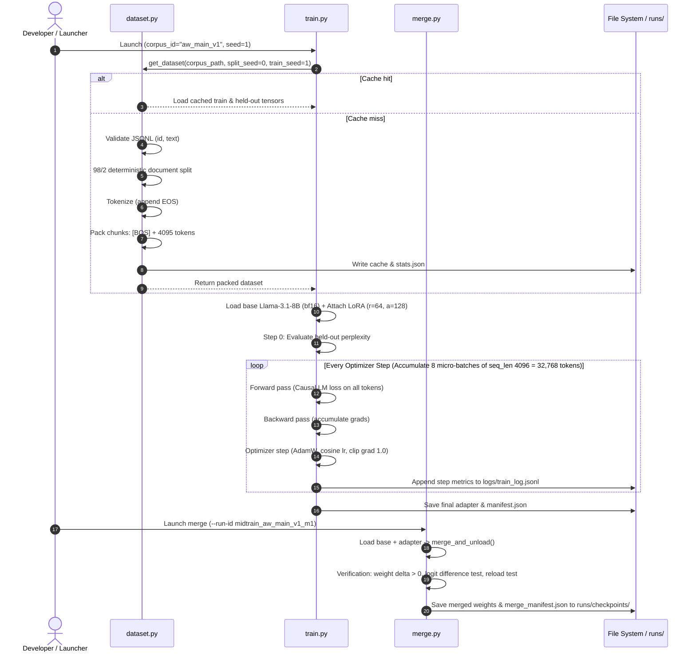

# Blueprint: Stage 1 — Model Spec Midtraining (MSM) training code

**For:** implementation agent (Antigravity) · **Project:** `awmsm/` · **Methodology reference:** `AW_MSM_Methodology.md` (§4.4, §6.5, §8.1–8.3, §8.5, §13, Appendix I)

**Scope of this blueprint:** MSM training only (packing, training, merging, smoke test). AFT is a separate, later blueprint, but the code should be structured so AFT plugs into the same trainer (see §11).

**Status rule:** where this blueprint and the methodology doc disagree, this blueprint wins for the items it explicitly changes; otherwise the methodology doc wins. If anything is ambiguous, **stop and ask** rather than choosing silently.

---

## 1. Goal

Train a LoRA adapter on a base model with next-token prediction over raw synthetic documents (loss on all tokens), then merge it into bf16 weights to produce the starting checkpoint for AFT.

```
corpus.jsonl ──► split (98/2) ──► tokenize + pack (4096) ──► LoRA train (1 epoch) ──► adapter
                                                                                       │
base model (bf16) ─────────────────────────────────────────────────────────────► merge ──► runs/checkpoints/midtrain_{corpus}_m{seed}/
```

---

## 2. Inputs

### 2.1 Corpus contract (MUST be schema-tolerant)

- Path: `data/corpora/{corpus_id}/corpus.jsonl`, one JSON object per line.
- **Required fields: `id` (str, unique), `text` (str, non-empty). Nothing else may be required.**
- All other fields (`n_tokens`, `doc_type`, `perspective`, `species_group`, nested `tags`, etc.) are **passed through unused**. The data-generation side may change these; the training code must not break.
- Validation on load (fail loudly with line numbers): invalid JSON, missing/empty `text`, duplicate `id`.

### 2.2 Base model

- Default: `meta-llama/Llama-3.1-8B` (**base**, not Instruct). Path configurable (`model.base_path`) for local copies.
- Tokenizer: the base model's own tokenizer. Do **not** add new special tokens.

---

## 3. Data preparation (`src/awmsm/train/dataset.py`)

### 3.1 Held-out split
- Deterministic, **by document** (never split a document across train/held-out).
- Rule: sort by `id`, assign held-out if `sha256(f"{split_seed}:{id}")` falls in the lowest 2% (`data.heldout_frac = 0.02`, `data.split_seed = 0`). This is stable across reruns and independent of file order.
- `split_seed` is **fixed across all corpora and seeds** (it is not the training seed).

### 3.2 Tokenization
- `tokenizer(text, add_special_tokens=False)` per document, then append `eos_token_id` (`<|end_of_text|>`) after every document.
- Packed sequence format: `[<|begin_of_text|>] + tokens…` — **one BOS at the start of each 4096-token packed sequence** (i.e. 4095 content tokens + BOS). Rationale: matches how the base model was pretrained and how AFT/inference sequences will begin.

### 3.3 Packing
- Shuffle document order with `train.seed` (data-order seed), concatenate, and cut into fixed chunks of `seq_len = 4096`.
- Documents longer than one chunk continue into the next chunk (allowed).
- **Drop the final partial chunk** (no padding). Log how many tokens were dropped.
- Labels = input_ids (loss on all tokens, including EOS separators; BOS position excluded automatically by the causal shift).
- Standard causal attention over the packed sequence (no per-document attention mask). This is the usual pretraining practice; record it in the run manifest as `attention_across_docs: true`.
- Held-out set is packed the same way (its own chunks).

### 3.4 Caching
- Cache the tokenized/packed dataset to `data/cache/{corpus_id}/{hash}/`, where `hash = sha256(corpus file bytes + tokenizer name/revision + seq_len + split rule + seed)`. Reuse if present.

### 3.5 Token accounting (gate G3 support)
Write `stats.json` next to the run with:
`n_docs_total, n_docs_train, n_docs_heldout, tokens_train_raw, tokens_heldout_raw, n_train_sequences, tokens_trained (= n_train_sequences × 4096), tokens_dropped_tail`.

- **Definition:** the midtraining budget refers to `tokens_trained` (train split, after packing). The same definition applies to every corpus.
- If `config.budget.target_tokens` is set, compare `tokens_trained` against it with `config.budget.tolerance` (default 0.02). **Warn** by default; **fail** if `config.budget.enforce: true` (production runs set this to true; the smoke test does not).

---

## 4. Model and LoRA (`src/awmsm/train/train.py`)

| Item | Value |
|---|---|
| Base weights dtype | bf16 |
| Precision mode | **bf16 LoRA** (no quantization). QLoRA is **not** used unless explicitly approved later — and then it must apply to **every** arm (methodology §4.4). |
| LoRA rank / alpha / dropout | 64 / 128 / 0.0, `bias="none"` |
| Target modules | `q_proj, k_proj, v_proj, o_proj, gate_proj, up_proj, down_proj` |
| Gradient checkpointing | on; `use_cache=False` during training |
| Attention implementation | `sdpa` by default (configurable). FlashAttention only if verified to build/run on Blackwell (sm_120) **and** used identically for all runs. |

---

## 5. Optimisation

| Hyperparameter | Value | Note |
|---|---|---|
| Optimiser | `torch.optim.AdamW` (fused if available), betas (0.9, 0.999), eps 1e-8 | Same everywhere |
| Learning rate | 1e-4 | MSM Appendix B.4 |
| Schedule | cosine to 0, warmup = `ceil(0.05 × total_steps)` | |
| Weight decay | 0.01 (LoRA params only) | |
| Grad clipping | max-norm 1.0 | Not specified in MSM; fixed here and recorded |
| Epochs | 1 | |
| `seq_len` | 4096 | |
| **Micro-batch × grad-accum** | **1 × 8 = 8 sequences = 32,768 tokens/step** | **FIXED for every run on every machine** (see below) |
| Loss | mean token-level CE over all tokens in the full accumulated batch | All sequences are full length, so this equals averaging per micro-batch; still implement it as total-loss / total-tokens so the same code is correct for AFT later |

**Why micro-batch is fixed:** the same effective batch with different micro-batch shapes is mathematically equivalent here, but not bit-identical numerically, and it would *not* be equivalent for AFT unless loss normalisation is handled carefully. Fixing one setting for every arm and machine removes the question. The 96 GB card will be under-utilised at micro-batch 1; that is an accepted cost for comparability.

**Seeds:** one `train.seed` controls data order, LoRA init, dropout (none) and torch/numpy/python RNGs. Set `torch.backends.cuda.matmul.allow_tf32` explicitly (same value everywhere) and record it.

---

## 6. Logging, evaluation, checkpoints

- Log every step: train loss, lr, grad-norm, tokens/s, peak GPU memory (`torch.cuda.max_memory_allocated`).
- Held-out loss (and perplexity) at step 0, every `eval_every` steps (default 25), and at the end.
- Save the adapter at the end; also save a resumable checkpoint (adapter + optimiser + scheduler + RNG + step) every `save_every` steps (default 50). `--resume` continues from the latest checkpoint and must reproduce the same data order.
- Local logs (CSV/JSONL) are **required**; W&B/MLflow optional.

---

## 7. Merge (`src/awmsm/train/merge.py`)

1. Load base model in bf16 (CPU is fine), apply the adapter, `merge_and_unload()`.
2. Save the merged model **and tokenizer** to `runs/checkpoints/midtrain_{corpus_id}_m{seed}/` (safetensors).
3. **Verification (must pass, else delete output and fail):**
   - At least one LoRA-targeted weight differs from base (delta norm > 0).
   - Logit check: on 4 held-out sequences, max |logits(base+adapter) − logits(merged)| below a tolerance (record the tolerance; bf16 differences are expected to be small but non-zero).
   - The merged checkpoint reloads with `AutoModelForCausalLM.from_pretrained`.
4. Write a merge manifest (adapter hash, base revision, output hash).

---

## 8. Run naming, paths and manifest

- Run id: `midtrain_{corpus_id}_m{seed}` (e.g. `midtrain_aw_main_v1_m1`).
- Adapter: `runs/midtrain/{run_id}/adapter/` · Logs/stats: `runs/midtrain/{run_id}/` · Merged: `runs/checkpoints/{run_id}/`.
- `manifest.json` (required) contains: full resolved config, git commit, SHA-256 of `corpus.jsonl`, dataset-cache hash, base model id + revision, tokenizer revision, library versions (torch, transformers, peft, accelerate, CUDA), GPU name + VRAM, hostname, `allow_tf32`, attention implementation, seed, start/end time, `stats.json` contents.

---

## 9. Hardware and GPU sharing

- **Default host: `wtc11` (RTX PRO 6000, 96 GB).** Midtraining runs there (methodology Appendix I.3).
- **24 GB machine:** allowed for midtraining **only if** the identical configuration (bf16 LoRA, 1 × 8, seq 4096, gradient checkpointing) fits. The smoke test must check this on the 24 GB card too. If it does not fit, midtraining stays on wtc11 — **do not switch precision or batch shape for some runs only**.
- **The same GPU is also used for data generation (vLLM).** The launcher MUST run a pre-flight check: query free GPU memory and refuse to start if below `hardware.min_free_gb` (configurable; set from the smoke test's measured peak + margin). Never assume the card is empty.
- Record the GPU model in every manifest.

---

## 10. Config and CLI

`configs/train_midtrain.yaml` (example):

```yaml
mode: midtrain
model:
  base_path: meta-llama/Llama-3.1-8B
  dtype: bfloat16
  attn_implementation: sdpa
lora: {r: 64, alpha: 128, dropout: 0.0, target_modules: [q_proj,k_proj,v_proj,o_proj,gate_proj,up_proj,down_proj]}
data:
  corpus_id: aw_main_v1
  corpus_path: data/corpora/aw_main_v1/corpus.jsonl
  seq_len: 4096
  heldout_frac: 0.02
  split_seed: 0
budget: {target_tokens: null, tolerance: 0.02, enforce: false}
train:
  seed: 1
  micro_batch_size: 1
  grad_accum_steps: 8
  lr: 1.0e-4
  schedule: cosine
  warmup_frac: 0.05
  weight_decay: 0.01
  max_grad_norm: 1.0
  epochs: 1
  gradient_checkpointing: true
  allow_tf32: true
  eval_every: 25
  save_every: 50
  max_steps: null        # smoke test sets e.g. 50
hardware: {min_free_gb: null}
```

CLI:

```bash
python -m awmsm.train.train --config configs/train_midtrain.yaml --corpus-id aw_main_v1 --seed 1 [--max-steps 50] [--resume]
python -m awmsm.train.merge --run-id midtrain_aw_main_v1_m1
scripts/run_train.sh ...   # sets CUDA_VISIBLE_DEVICES, runs pre-flight, writes manifest
```

---

## 11. Design for AFT later (do not implement AFT now)

- `train.py` takes `--mode {midtrain, aft}`; only `midtrain` is implemented now. Keep model loading, LoRA setup, optimiser, logging, checkpointing and manifest code shared.
- Implement loss as **sum of token losses / number of loss tokens in the whole accumulated batch** (so AFT's variable assistant-token counts will be handled correctly without changes).
- AFT will need: chat template from `configs/chat_template.jinja`, assistant-only loss on **every** assistant turn, and a **tokenization-parity test** against vLLM. These are for the AFT blueprint.

---

## 12. Tests and smoke test

### Unit tests (`tests/`)
1. Corpus loader: accepts extra/missing optional fields; rejects missing `text`, empty `text`, duplicate `id`.
2. Split: deterministic across runs and file orderings; no document in both splits; ~2% held-out.
3. Packing: every sequence is exactly 4096 tokens and starts with BOS; EOS appears between documents; total tokens add up (`trained + dropped = raw + BOS/EOS overhead`).
4. Loss normalisation: token-weighted loss over accumulated micro-batches equals the loss on the concatenated batch (synthetic test).
5. Merge verification functions detect a zero-delta adapter.

### Smoke test (`scripts/smoke_test_training.py`), on existing `aw_main_v1`
Results are for code validation only and **must not** be used as experimental results.

1. 50 midtraining steps on wtc11 → merge → verify.
2. Same 50 steps on the 24 GB card (when available): report whether it fits.
3. Acceptance criteria:
   - Training loss decreases; held-out loss at step 50 < step 0.
   - No NaN/inf; grad-norm finite.
   - Merge verification passes.
   - Merged model generates coherent continuations of a raw-text prompt (load in vLLM with plain completion, not chat).
   - `--resume` from the step-25 checkpoint reproduces the step-50 loss within tolerance.
4. Report: tokens/s, peak memory per GPU type, wall-clock estimate for a 5M-token run, and the recommended `hardware.min_free_gb`.

---

## 13. Out of scope for this blueprint

AFT data building, chat templates, evaluation, vLLM serving of trained models for evals, washout runs, steering. Do not implement these now.

## 14. Decisions the implementer must ask about (do not decide silently)

- Any deviation from bf16 LoRA, the 1 × 8 batch shape, or the hyperparameters above.
- Any change to the corpus contract (§2.1) or the token-budget definition (§3.5).
- Library versions if Blackwell (sm_120) support forces a specific torch/transformers combination — record and report them.

---

# Appendix: Implementation Architecture & Code Flow

## 1. Final File & Folder Structure

Below is the complete file and folder structure for the MSM stage within the `awmsm/` repository:

```
awmsm/
├── configs/
│   ├── base.yaml                     # Shared project paths, identity ("Aster"), and base model config
│   └── train_midtrain.yaml           # [MODIFIED] Fully resolved Stage-1 hyperparameters (LoRA, 1x8, lr, etc.)
│
├── src/awmsm/
│   └── train/
│       ├── __init__.py
│       ├── dataset.py                # [NEW] Corpus ingestion, deterministic 98/2 split, packing, caching
│       ├── train.py                  # [NEW/REPLACED] Main trainer: LoRA init, 1x8 accum, loss, logging, checkpointing
│       └── merge.py                  # [NEW/REPLACED] Merges adapter into base bf16; runs logit & delta verification
│
├── scripts/
│   ├── run_train.sh                  # [NEW] Shell launcher: GPU check, CUDA_VISIBLE_DEVICES, writes manifest
│   └── smoke_test_training.py        # [NEW] 50-step end-to-end smoke test on existing aw_main_v1
│
├── tests/
│   └── test_midtrain.py              # [NEW] Unit tests: loader tolerance, split, packing, loss math, merge checks
│
├── data/
│   ├── corpora/
│   │   └── {corpus_id}/
│   │       └── corpus.jsonl          # Input dataset (aw_main_v1 or new version)
│   └── cache/
│       └── {corpus_id}/
│           └── {hash}/               # Cached tokenized/packed train & held-out tensors
│
└── runs/                             # Generated runtime outputs (gitignored)
    ├── midtrain/
    │   └── {run_id}/                 # e.g., midtrain_aw_main_v1_m1/
    │       ├── adapter/              # Final LoRA adapter weights (adapter_model.safetensors, adapter_config.json)
    │       ├── checkpoints/          # Resumable step checkpoints (step_50/, step_100/...)
    │       ├── logs/                 # Step metrics (train_log.jsonl, train_log.csv)
    │       ├── stats.json            # Token accounting (trained, dropped, splits)
    │       └── manifest.json         # Complete provenance (git commit, data sha256, GPU info, library versions)
    └── checkpoints/
        └── {run_id}/                 # Merged standalone bf16 model + tokenizer + merge_manifest.json
```

---

## 2. Detailed Purpose of Each File & Directory

### A. Configuration
* **`configs/train_midtrain.yaml`**
  * **Purpose:** Single source of truth for Stage-1 training.
  * **Contents:**
    * Base model path (`meta-llama/Llama-3.1-8B`) and `sdpa` attention.
    * LoRA configuration ($r=64, \alpha=128$, dropout 0.0, all 7 projection matrices).
    * Data paths, `seq_len: 4096`, `heldout_frac: 0.02`, `split_seed: 0`.
    * Token budget targets and tolerance (warn vs. enforce).
    * Fixed optimization knobs: `micro_batch_size: 1`, `grad_accum_steps: 8`, `lr: 1e-4`, cosine schedule with 5% warmup, weight decay 0.01, gradient clipping 1.0, `allow_tf32: true`.

### B. Core Training Modules (`src/awmsm/train/`)
* **`src/awmsm/train/dataset.py`**
  * **Purpose:** Robust data ingestion, determinism, and pretraining-style chunk packing.
  * **Functionality:**
    1. *Corpus Loader:* Streams `data/corpora/{corpus_id}/corpus.jsonl`. Rejects missing/empty `text` or duplicate `id`. Passes through all auxiliary fields cleanly.
    2. *Deterministic Split:* Evaluates `sha256(f"0:{doc_id}")`. Lowest 2% assigned to held-out validation; remaining 98% to train split.
    3. *Packing Engine:* Tokenizes without special tokens, appends `<|end_of_text|>` after every document, shuffles documents with `train.seed`, and slices into 4096-token blocks formatted as `[<|begin_of_text|>] + 4095 tokens`. Discards the final partial chunk.
    4. *Disk Cache:* Computes a SHA-256 fingerprint of `(raw corpus bytes + tokenizer + seq_len + split + seed)` and caches the packed tensor arrays to `data/cache/` so reruns start instantly.
    5. *Token Accounting:* Writes `stats.json` detailing raw tokens, trained tokens, and dropped tail tokens.

* **`src/awmsm/train/train.py`**
  * **Purpose:** CLI and training engine for next-token prediction midtraining (and future AFT).
  * **Functionality:**
    1. Sets global RNG seeds (`torch`, `numpy`, `random`) and `torch.backends.cuda.matmul.allow_tf32 = True`.
    2. Loads base model in `bfloat16` with gradient checkpointing enabled and attaches the PEFT LoRA adapter.
    3. Executes the 1-epoch loop with micro-batch 1 and gradient accumulation 8.
    4. Loss computation: computes $\frac{\sum \text{token losses}}{\sum \text{valid tokens}}$ across the accumulated batch.
    5. Evaluates held-out perplexity at step 0, every 25 steps, and upon completion.
    6. Saves rolling resumable checkpoints (weights, optimizer, scheduler, RNG state) every 50 steps, allowing `--resume` to cleanly pick up mid-run.
    7. Generates `manifest.json` recording environment details, GPU hardware, data hashes, and training loss curves.

* **`src/awmsm/train/merge.py`**
  * **Purpose:** Merges the trained LoRA adapter into standalone `bfloat16` weights for downstream AFT.
  * **Functionality:**
    1. Loads base model and LoRA adapter from `runs/midtrain/{run_id}/adapter/`.
    2. Calls `model.merge_and_unload()` and saves the merged model and tokenizer to `runs/checkpoints/{run_id}/`.
    3. *Verification Gate:*
       - Asserts parameter delta norm $> 0$ (adapter was not an empty identity).
       - Compares logits between unmerged (`base + adapter`) and merged model on 4 held-out sequences (asserts max absolute difference $\le \epsilon$).
       - Reloads the saved checkpoint with `AutoModelForCausalLM` to verify file integrity.
    4. Writes `merge_manifest.json`.

### C. Execution Scripts (`scripts/`)
* **`scripts/run_train.sh`**
  * **Purpose:** Production execution wrapper.
  * **Functionality:**
    1. Sets environment (`PYTHONPATH=src`, `HF_HOME`).
    2. Queries GPU memory via `nvidia-smi` to ensure required free VRAM (`hardware.min_free_gb`) is available.
    3. Launches `python -m awmsm.train.train` and tees output to a logfile.
    4. Automatically invokes `python -m awmsm.train.merge` on successful completion.

* **`scripts/smoke_test_training.py`**
  * **Purpose:** Quick integration test validating the entire pipeline on `aw_main_v1`.
  * **Functionality:**
    1. Trains for 50 steps with `--max-steps 50`.
    2. Verifies loss decrease and finite gradient norms.
    3. Runs adapter merge and verification.
    4. Tests `--resume` from step 25 to verify loss reproducibility.
    5. Measures tokens/sec and peak VRAM, providing concrete time estimates for a full 2.5M / 5.0M token run.

### D. Unit Tests (`tests/`)
* **`tests/test_midtrain.py`**
  * **Purpose:** Fast unit tests (no GPU required):
    1. *Corpus schema test:* validates handling of extra fields, missing fields, duplicate IDs.
    2. *Split test:* verifies determinism and disjointness of the 98/2 document split.
    3. *Packing test:* verifies 4096-token sequence lengths, BOS positioning, EOS document separators, and token conservation.
    4. *Loss accumulation test:* asserts token-weighted loss over accumulated micro-batches equals full-batch loss.
    5. *Merge check test:* ensures merge verification detects a dummy/zero adapter.

---

## 3. End-to-End Code Flow Walkthrough



---

## 4. Execution Commands Reference

### A. Run Unit Tests (with live display + log saving)
```bash
cd /mnt/HDD_2TB/niraj/awmsm

/mnt/HDD_2TB/niraj/venvs/vllm/bin/python -m pytest tests/test_midtrain.py -v \
  2>&1 | tee /mnt/HDD_2TB/niraj/logs/unit_tests_midtrain.log
```

### B. Run Smoke Test (50 Steps on GPU with live display + log saving)
```bash
cd /mnt/HDD_2TB/niraj/awmsm

HF_HOME=/mnt/HDD_2TB/niraj/hf PYTHONPATH=src \
  /mnt/HDD_2TB/niraj/venvs/vllm/bin/python scripts/smoke_test_training.py \
  --corpus-id aw_main_v11 \
  --max-steps 50 \
  --log-name smoke_test_aw_v11.log \
  2>&1 | tee /mnt/HDD_2TB/niraj/logs/smoke_test_aw_v11.log
```

### C. Run Both Sequentially
```bash
cd /mnt/HDD_2TB/niraj/awmsm && \
/mnt/HDD_2TB/niraj/venvs/vllm/bin/python -m pytest tests/test_midtrain.py -v 2>&1 | tee /mnt/HDD_2TB/niraj/logs/unit_tests_midtrain.log && \
HF_HOME=/mnt/HDD_2TB/niraj/hf PYTHONPATH=src /mnt/HDD_2TB/niraj/venvs/vllm/bin/python scripts/smoke_test_training.py --corpus-id aw_main_v11 --max-steps 50 --log-name smoke_test_aw_v11.log 2>&1 | tee /mnt/HDD_2TB/niraj/logs/smoke_test_aw_v11.log
```

### D. Run Full Midtraining via Production Launcher
```bash
cd /mnt/HDD_2TB/niraj/awmsm

# Syntax: ./scripts/run_train.sh [CONFIG] [CORPUS_ID] [SEED] [GPU_ID] [CUSTOM_LOG_NAME]
./scripts/run_train.sh configs/train_midtrain.yaml aw_main_v11 1 0 midtrain_v11_seed1.log
```

### E. Background Execution via GNU Screen
```bash
# 1. Start a named screen session
screen -S emergent_alignment

# 2. Run the desired command inside screen
./scripts/run_train.sh configs/train_midtrain.yaml aw_main_v11 1 0 midtrain_v11_seed1.log

# 3. Detach safely (leaves job running when SSH disconnects):
#    Press Ctrl+A, release, then press D

# 4. Reattach anytime:
screen -r emergent_alignment

# 5. Monitor log from another shell:
tail -f /mnt/HDD_2TB/niraj/logs/midtrain_v11_seed1.log
```


